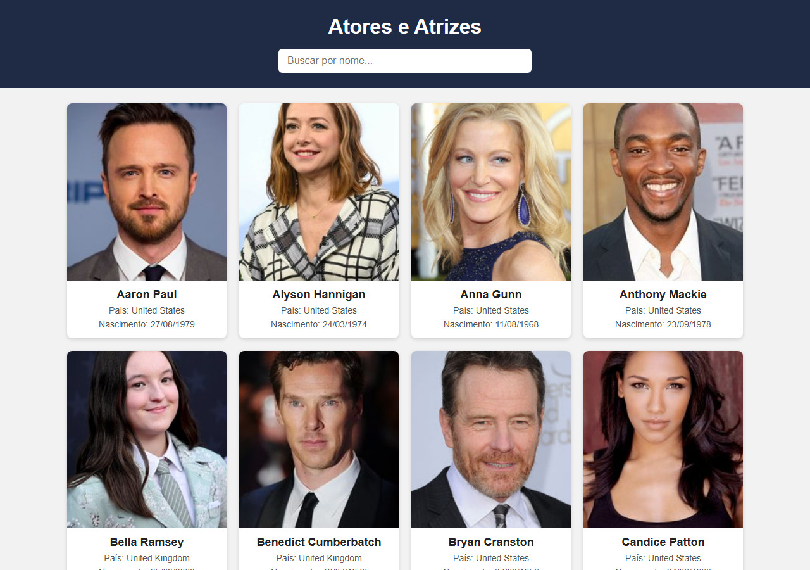
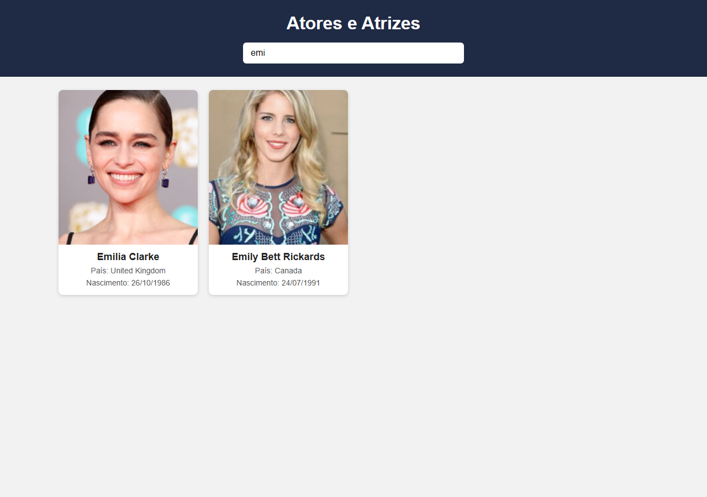

# Atores e Atrizes

Aplicativo web desenvolvido para o CheckPoint 2 da disciplina de Application Development. Ele exibe atores e atrizes em um grid de cards e permite filtrá-los pelo nome conforme o usuário digita.

## Autor

Paulo Ribeiro Marinho - RM567459

## Funcionalidades

- Título da página.
- Renderização de todos os atores e atrizes do array em um grid de cards com foto, nome, país e data de nascimento.
- Campo de busca (`input type="text"`) que filtra os cards pelo nome em tempo real, usando `oninput`, `filter()` e `includes()`.
- Busca sem diferenciação entre maiúsculas e minúsculas.
- Mensagem exibida quando nenhum resultado é encontrado.

## Tecnologias

- HTML5
- CSS3 (CSS Grid)
- JavaScript

## Estrutura do projeto

```
.
├── index.html   estrutura da página
├── style.css    estilos e layout do grid
├── script.js    renderização dos cards e filtro
└── dados.js     array de objetos com os atores e atrizes
```

## Como executar

1. Baixe ou clone o repositório.
2. Abra o arquivo `index.html` em qualquer navegador.

Não é necessário instalar nenhuma dependência. As fotos são carregadas pela internet, portanto é preciso estar conectado.

## Fonte dos dados

Os dados vêm do arquivo `dados.js`, obtidos da API pública TVmaze (api.tvmaze.com). Cada objeto possui `id`, `nome`, `pais`, `nascimento` e `foto`.

## Snapshots

### Tela ao abrir



### Tela com filtro aplicado (busca por "emi")


